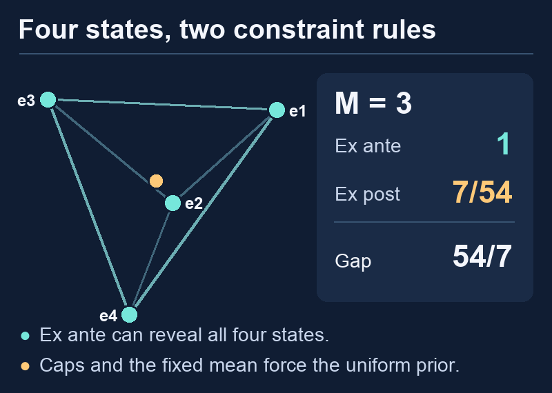

# The sharp ex-ante to ex-post gap in Bayesian persuasion

   

With *m* convex constraints and a sender utility with two-point Jensen factor *M*, the largest possible ratio of ex-ante to ex-post optimal utility is **(*m*+1)/A₍ₘ₊₁₎**. Here Aₙ is the largest sum of leaf discounts M⁻ᵈ over full binary trees with *n* leaves. Balanced trees give the formula for 1 ≤ M ≤ 2, and combs give it for M ≥ 2. The same ratio is the sharp supremum for Lipschitz utilities.

[Read the paper](paper/manuscript.pdf) · [LaTeX source](paper/manuscript.tex) · [Original question](https://arxiv.org/html/2012.03272v2#S5) · [Catalog Q489](https://github.com/10m-u/open-problems-catalog/blob/ca8d4d44ba3db527f19f28928c240168f545ecfe/problems/game_theory/algorithmic-game-theory-learning-network-games.md#q489) · [Version DOI](https://doi.org/10.5281/zenodo.24571504)

## Explore the proof in 3D

At M = 3, full revelation uses the four vertices and earns 1. The three coordinate caps and Bayes plausibility force an ex-post signal to use the uniform prior, whose utility is 7/54. The explorer lets you compare both feasible signals and watch the maximizing tree change at M = 2.

[Download the offline explorer](https://raw.githubusercontent.com/DannyExperiments/sharp-ex-ante-ex-post-persuasion/v1.0.0/visualization/persuasion-gap-explorer.zip) · [Explorer source](visualization/index.html) · [GIF rendering source](visualization/render.py)

## Why the proof works

Split the ex-ante signal into small pools that meet all expected caps. Each pool needs at most *m*+1 posteriors because it is free to change its own mean. Replacing each pool with its mean enforces the caps, and their mixture preserves the original prior. The binary-tree inequality bounds the utility loss for each pool. The four-state example illustrates the general sharp construction.

The original paper gives the exact one-constraint factor and its longer version gives the *m*+1 lower bound at M = 2. The discounted tree optimization comes from exponential prefix coding. [Source comparison](audits/public_safe_reports/LITERATURE.md).

## Reproduce the checks

    python3 -I scripts/verify_repository.py
    python3 -I verification/src/replay.py

The [recorded replay](verification/results/replay.txt) checks closed forms, Jensen inequalities, the worked example and an exact smoothing value. See [scope](CLAIM_SCOPE_AND_LIMITATIONS.md), [reproducibility](REPRODUCIBILITY.md) and the [research disclosure](AI_DISCLOSURE.md).

## Cite

DannyExperiments. *The sharp ex-ante to ex-post gap in Bayesian persuasion*. Version 1.0.0, 27 November 2026. [Version DOI](https://doi.org/10.5281/zenodo.24571504).
